# ☸️ Rapport de Labs Kubernetes - K3s

Bienvenue sur mon dépôt contenant l'ensemble des travaux pratiques réalisés sur un cluster Kubernetes K3s (1 master, 2 workers). 

Ce projet couvre les chapitres 3 à 6 du cours, allant de l'exposition d'applications jusqu'aux patterns multi-conteneurs avancés.

## 📂 Structure du Dépôt
- 📁 **`lab3.1/`** à **`lab6.2/`** : Contiennent tous les fichiers manifestes YAML utilisés.
- 📁 **`captures/`** : Contient les captures d'écran validant les points de contrôle de chaque étape.
- 📄 **`labs_kubernetes.pdf`** : Le rapport complet au format PDF avec les explications détaillées.

---

## 📚 Sommaire des Labs

### [Lab 3.1 : Exposer une application](./lab3.1)
**Concepts :** Services (ClusterIP, NodePort, LoadBalancer), Endpoints, DNS (CoreDNS).
- Déploiement de l'application `podinfo` (3 réplicas).
- Test de répartition de charge et diagnostic d'un sélecteur erroné.
- Exposition externe testée depuis Windows.

> **Preuves (Captures) :**
> *Endpoints du service ClusterIP :*
> 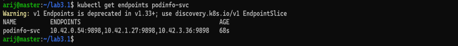
> *Répartition de charge :*
> 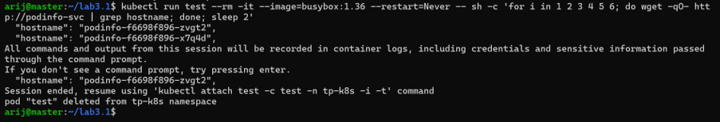
> *Test NodePort depuis Windows :*
> 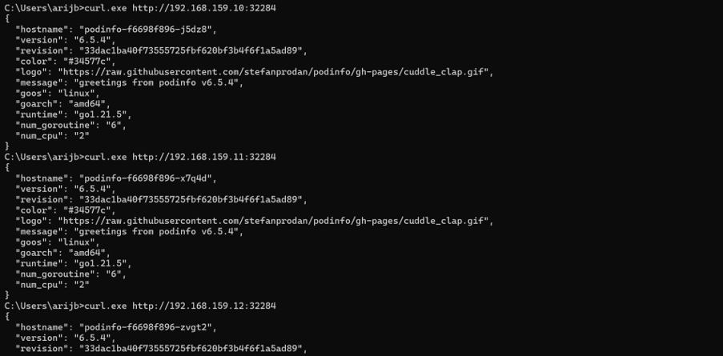
> *Test LoadBalancer depuis Windows :*
> 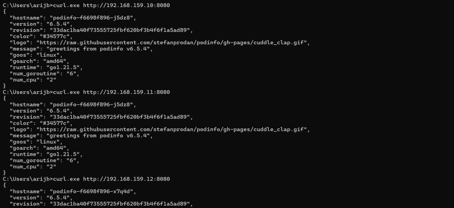

---

### [Lab 3.2 : Ingress avec Traefik](./lab3.2)
**Concepts :** Ingress Controller, routage par nom d'hôte et par chemin.
- Configuration de règles de routage pour `web.k3s.local` et `api.k3s.local`.
- Routage par chemin (`/` vers Nginx, `/version` vers l'API).
- Modification du fichier `hosts` Windows pour tester dans un navigateur.

> **Preuves (Captures) :**
> *Règles de routage de l'Ingress :*
> 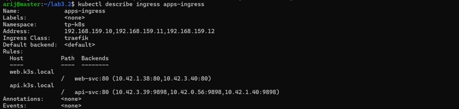
> *Routage par nom d'hôte (Navigateur) :*
> 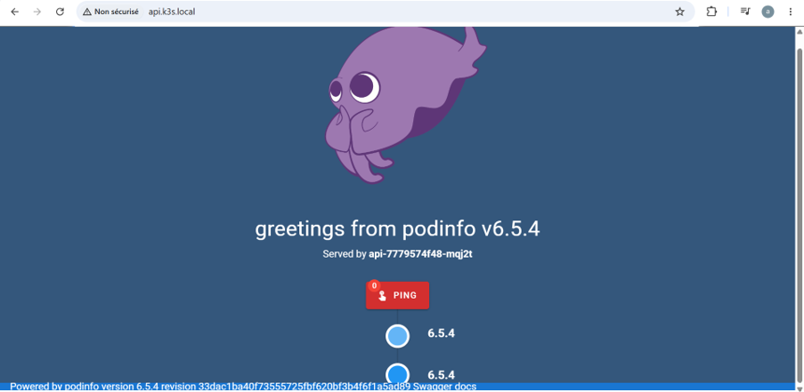
> *Routage par chemin (`/version`) :*
> 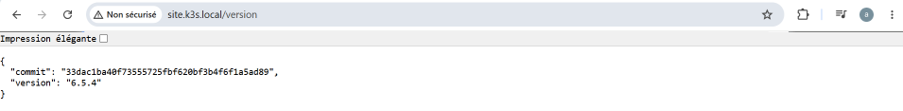
> *Erreur de routage Traefik vs Application Nginx :*
> 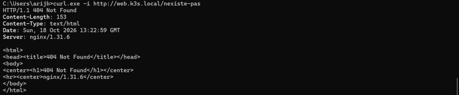

---

### [Lab 4.1 : Externaliser la configuration](./lab4.1)
**Concepts :** ConfigMap et Secret.
- Injection de variables d'environnement et de fichiers de configuration.
- Diagnostic d'un Pod bloqué (`CreateContainerConfigError`) à cause d'un ConfigMap manquant.

> **Preuves (Captures) :**
> *Injection des variables (ConfigMap/Secret) :*
> 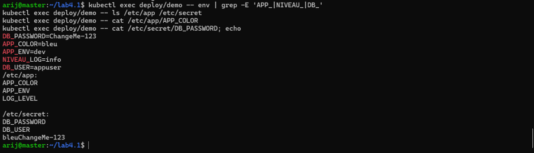
> *Pod en erreur (ConfigMap manquant) :*
> 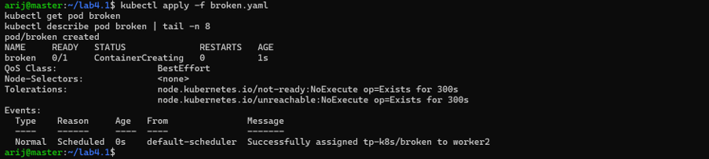

---

### [Lab 4.2 : Maîtriser les ressources](./lab4.2)
**Concepts :** Requests, Limits, OOMKilled, ResourceQuota, LimitRange.
- Simulation d'un manque de mémoire (`Pending`) et d'un dépassement (`OOMKilled` - Exit Code 137).
- Observation du bridage CPU (le conteneur ralentit mais ne meurt pas).
- Sécurisation d'un namespace avec des quotas stricts.

> **Preuves (Captures) :**
> *Pod en attente (Insufficient memory) :*
> 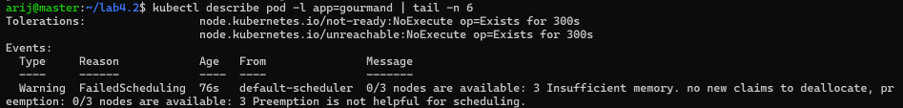
> *Diagnostic d'un OOMKilled :*
> 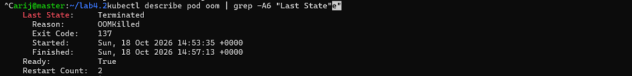
> *Limite CPU (top pods) :*
> 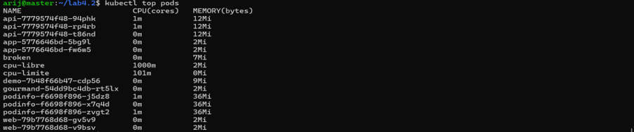
> *Refus de création (Exceeded Quota) :*
> 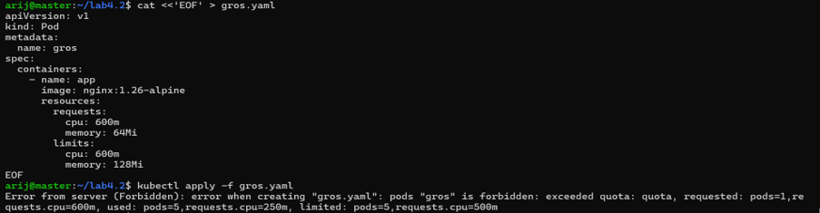

---

### [Lab 5.1 : Volumes persistants](./lab5.1)
**Concepts :** emptyDir, PVC, PV, StorageClass (local-path).
- Démonstration de la perte de données avec `emptyDir` et de la persistance avec PVC.
- Suppression d'un PVC et observation de la politique de rétention `Delete`.
- Diagnostic d'un PVC bloqué en `Pending`.

> **Preuves (Captures) :**
> *PVC à l'état Bound :*
> 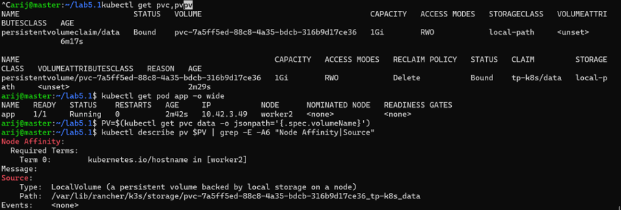
> *Preuve de persistance après suppression du Pod :*
> 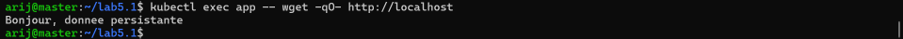
> *PVC bloqué en Terminating :*
> 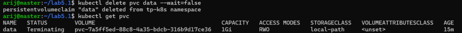
> *Erreur de StorageClass introuvable :*
> 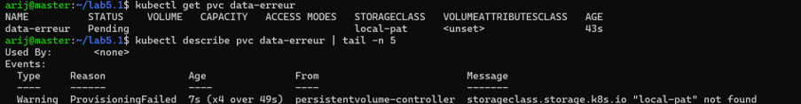

---

### [Lab 5.2 : Base de données avec StatefulSet](./lab5.2)
**Concepts :** StatefulSet, Service Headless, ConfigMap, Secret.
- Déploiement de PostgreSQL avec identité stable (`db-0`).
- Preuve que les données survivent à la suppression du Pod.
- Démonstration que le réplica `db-1` possède son propre volume isolé.
- Compréhension de l'initialisation du mot de passe.

> **Preuves (Captures) :**
> *Persistance des données après recréation du Pod :*
> 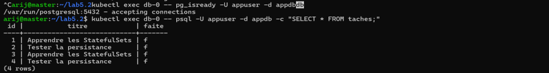
> *Résolution DNS du Service Headless :*
> 
> *Isolation des données entre db-0 et db-1 :*
> 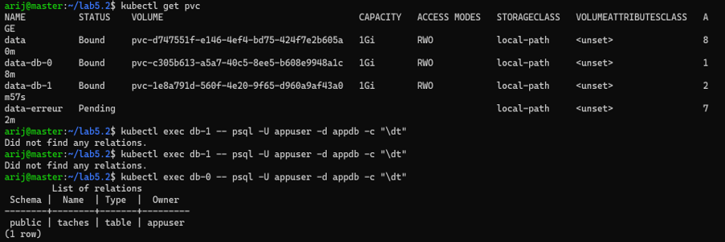
> *Échec d'authentification avec le nouveau mot de passe :*
> 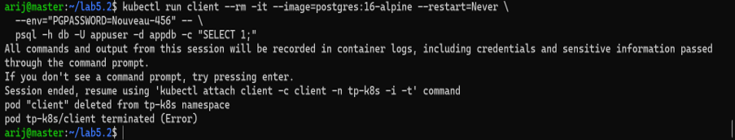

---

### [Lab 6.1 : Jobs et CronJobs](./lab6.1)
**Concepts :** Jobs, CronJobs, Parallélisme, TTL.
- Exécution de Jobs ponctuels et gestion des échecs (`backoffLimit`).
- Job parallèle (6 tâches, 2 simultanées) avec auto-destruction.
- Planification de sauvegardes automatiques toutes les minutes sur un PVC.

> **Preuves (Captures) :**
> *Job simple terminé avec succès :*
> 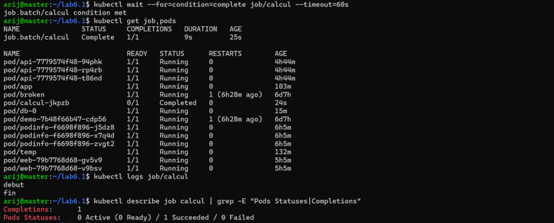
> *Job en échec (BackoffLimitExceeded) :*
> 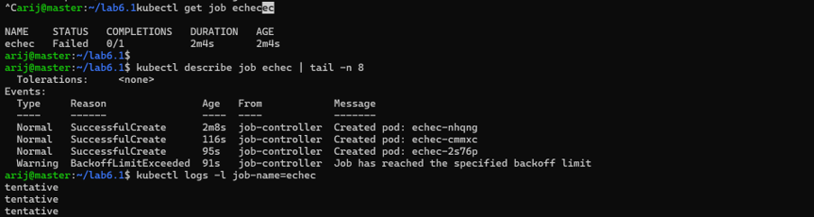
> *Job parallèle (6/6 complétées) :*
> 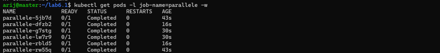
> *Planification réussie du CronJob :*
> 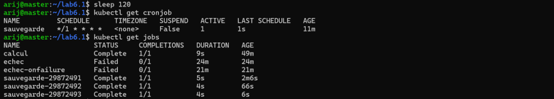
> *Fichiers de sauvegarde générés dans le PVC :*
> 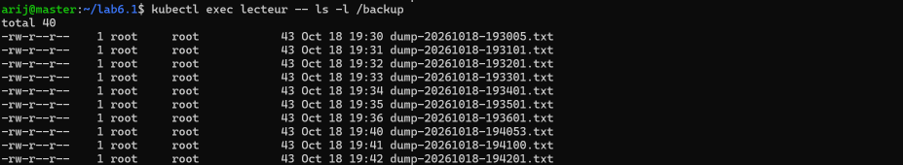

---

### [Lab 6.2 : Patterns multi-conteneurs](./lab6.2)
**Concepts :** Init Containers, Sidecar, Réseau partagé, Ambassador.
- Utilisation d'init containers pour attendre une dépendance réseau.
- Pattern Sidecar : lecture de logs via un volume partagé.
- Pattern Ambassador : proxy Nginx local pour joindre un backend distant.

> **Preuves (Captures) :**
> *Pod bloqué en Init:0/2 (attente du backend) :*
> 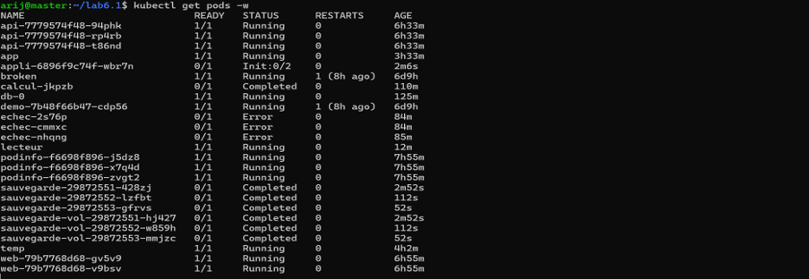
> *Échec d'un Init Container :*
> 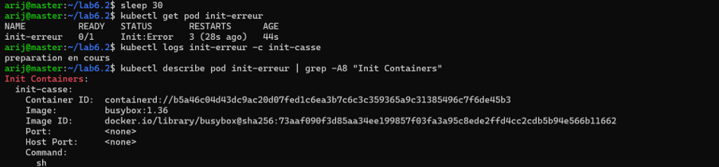
> *Pattern Sidecar : lecture des logs via un 2ème conteneur :*
> 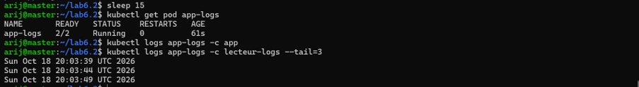
> *Réseau partagé (localhost) entre deux conteneurs :*
> 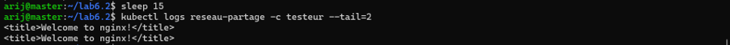
> *Pattern Ambassador (Proxy local) :*
> 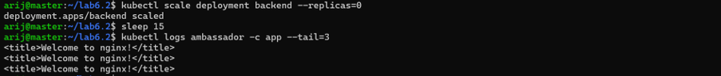

---
*Rapport généré par Arij Belaid - 2026*
